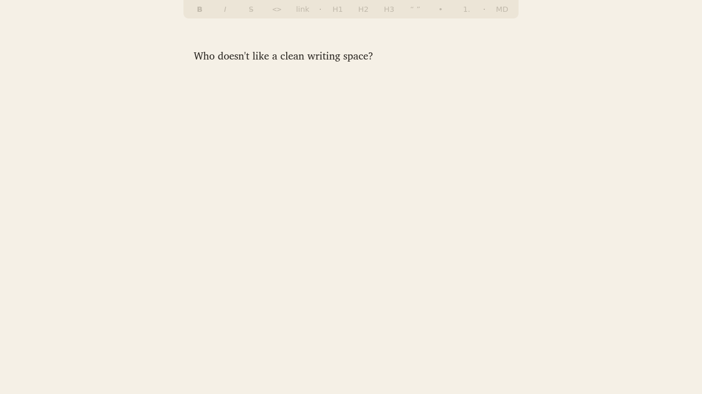

# draft

A minimal, distraction-free Markdown writing app for Linux (GTK4 + Python).



Documents are plain `.md` files in `~/Writing`. You write in a clean, formatted
view: type `**bold**`, `*italic*`, `# heading`, `> quote`, `- list` and the
markers vanish once the span is complete, reappearing when the cursor is back
inside so you can edit them. A small toolbar inserts the same Markdown, and a
raw view (`Ctrl+R`) shows the file exactly as it is on disk.

- Autosaves about 1.5 seconds after you stop typing, and on switch or quit
- Centred column, typewriter scrolling, serif or mono
- Seven colour themes, plus an optional background image under a tinted overlay
- Quick open with fuzzy search across your documents

## Requirements

Python 3, GTK 4 (≥ 4.10) and PyGObject. On Debian/Ubuntu:

```sh
sudo apt install python3-gi gir1.2-gtk-4.0
```

It looks best with the Charis SIL and Go Mono fonts (`fonts-sil-charis`, `fonts-go`).

## Install

```sh
ln -s "$PWD/draft.py" ~/.local/bin/draft
draft            # or: draft path/to/file.md
```

In sway, bind it to a key:

```
bindsym $mod+n exec draft
```

## Keys

| Writing | | Files & view | |
|---|---|---|---|
| `Ctrl+B` | bold | `Ctrl+N` | new document |
| `Ctrl+I` | italic | `Ctrl+O` | open document |
| `Ctrl+D` | strikethrough | `Ctrl+R` | raw markdown view |
| `Ctrl+E` | inline code | `Ctrl+T` | cycle themes |
| `Ctrl+K` | link | `Ctrl+M` | serif / mono |
| `Ctrl+1`–`3` | heading | `Ctrl+=` / `Ctrl+-` | font size |
| `Ctrl+0` | plain paragraph | `Ctrl+Y` | typewriter scrolling |
| `Ctrl+L` | bullet list | `Ctrl+Shift+I` | status line (word count) |
| `Ctrl+Shift+L` | numbered list | `Ctrl+\` | toolbar |
| `Ctrl+'` | quote | `Ctrl+Shift+F` | fullscreen |
| | | `Ctrl+Shift+O` | choose background image |
| | | `Ctrl+Shift+T` | background image on / off |
| | | `Ctrl+[` / `Ctrl+]` | more / less image |
| | | `Ctrl+Q` | quit |

`Ctrl+/` shows the keys in the app. Typing `--` produces an em dash.

Settings are remembered in `~/.local/state/draft/state.json`. Set `DRAFT_DIR` to
keep documents somewhere other than `~/Writing`.

## License

MIT. See [LICENSE](LICENSE).
